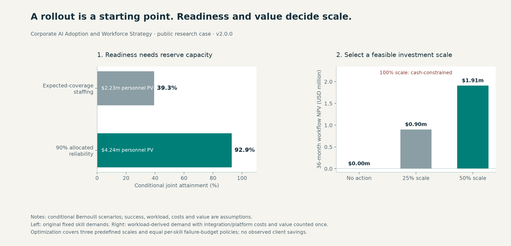

# Corporate AI Adoption and Workforce Strategy

**What should follow an AI rollout: training, mobility, recruitment—or a smaller investment?**

This independently runnable research product connects bank adoption disclosures to task requirements, reliable staffing and an investment decision. Inspect an original statement, change the case, and download the assumptions with the result. Public study by Haojian Dui, developed with AI assistance; no client engagement or independent human-validation claim.

[Live application](https://joedhj.github.io/corporate-ai-adoption/) · [Executive brief](docs/executive-brief.md) · [Full case](docs/executive-report.md) · [Career evidence](docs/career-positioning.md) · [Release](https://github.com/JoeDHJ/corporate-ai-adoption/releases/tag/v2.0.0)



- **Use and risk coexist.** Eleven parsed FY2023–FY2025 reports from four bank groups yield 288 candidate locations and 30 reviewed spans. A Wells Fargo risk paragraph also states current use. Independent axes preserve both. BAC FY2025 remains a visible collection gap.
- **Expected coverage is a weak guarantee.** The original staffing plan has conditional joint attainment of 39.3%. A 90% allocated policy reaches 92.9%, increasing personnel PV cost from $2,229,643 to $4,238,221. Success rates are assumptions.
- **Value changes the personnel choice.** The base 50% scale selects 23 training candidates and two redeployments, with $1,907,704 modeled 36-month NPV. Full scale is infeasible under the combined $400,000 cash cap. No action is explicitly compared. Task times and value require actual measurement.

## Run independently

Python 3.11+; no third-party runtime dependencies. Download the release wheel, then:

```text
python -m pip install corporate_ai_adoption-2.0.0-py3-none-any.whl
corporate-ai demo --out output
corporate-ai workflow --out output/workflow-case.json
corporate-ai reliability --out output/reliability-case.json
```

Open output/index.html yourself, or serve output with `python -m http.server --directory output`. output/presentation.html opens directly into the eight-exhibit presentation. Both HTML files embed their public data and work offline. Imported cases stay local. The browser accepts 1–3 distinct skill pools, 30 candidates per route and matched USD 2026 amounts. Edit exported JSON for all task, timing and cost inputs. The CLI accepts `workflow --input case.json`, containing scenario and workflow objects.

```text
python -m pip install ".[dev]"
python -m pytest -q
node tests/strategy-parity.cjs
node tests/v2-parity.cjs
python -m build
```

## Inspect the evidence and methods

| Layer | Delivered proof | Interpretation |
| --- | --- | --- |
| Measurement | Sources, exact locators, 288 candidate locations, independent actor/stage/risk coding | Selected assistant reference judgments; no population adoption rate |
| Text methods | Grouped TF-IDF centroid, keyword/rule baselines, feature-deduplicated temporal check, axis errors | Development diagnostics; no human accuracy claim |
| Hiring | Five readable Citi vacancies and eleven collection outcomes | Targeted external demand; no hiring trend or bank comparison |
| Economics | Workload-derived demand, exact attainment, conservative reliability allocation, joint NPV choice | Conditional scenarios; no causal labor effect or observed savings |
| Research workflow | Six executed document-filtered retrieval tasks and source checks | Fixed assistant-authored task pack, not an unseen/human benchmark |
| Delivery | Offline app, complete presentation, Markdown briefs, schemas, CLI, wheel, CI | Reproducible without a paid model or sibling service |

The original ten-company corpus, Microsoft workforce stocks and BLS projections remain context in their original units. Corporate owns firm evidence and workforce decisions; Atlas, Career Fit and Impact remain optional snapshot consumers.

[Methods](docs/methodology.md) · [Knowledge framework](docs/knowledge-framework.md) · [Interface](docs/portfolio-interface.md) · [Review record](docs/review-log.md) · [Data rights](DATA_NOTICE.md)
