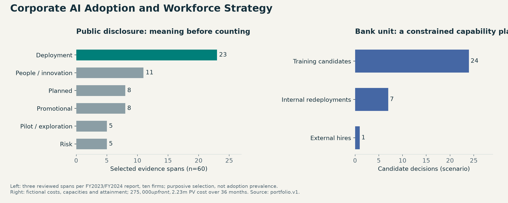

# Corporate AI Adoption and Workforce Strategy
Haojian Dui · 16 November 2026 · Version 1.0.0

## The management question

Which AI claims establish an operating use case, and what workforce investment should follow? The project combines a retrospective public-company evidence case with a reusable investment model. The evidence case measures company disclosures. The model turns explicit staffing, cost and timing assumptions into a feasible capability plan. This is a public portfolio study, with no claim of a paid engagement or access to internal company data.

An AI keyword count combines supplier products, internal deployments, planned investment, research, pilots and discussion of risks. A workforce decision requires a specific workflow, a capability requirement, an eligible candidate pool and a test of incremental value. Those objects organize this report and dashboard.

## 1. Public-company evidence

The peer group consists of Microsoft, Adobe, IBM, Accenture, Cisco, NVIDIA, Salesforce, Alphabet, JPMorgan Chase and Bank of America. These large US-listed issuers are relevant to enterprise AI supply or knowledge-intensive financial services. The purposive group permits statement-level comparison; it is not representative of all firms, industries or countries.

The reporting window is FY2023–FY2024, the early generative-AI adoption wave. Fiscal-year ends differ, including January year ends. Native fiscal labels are retained instead of relabeling observations as calendar years. Twenty official annual reports or filed 10-Ks were accessed on 16 November 2026. Raw documents remain in the ignored local collection directory. The public package contains short exact excerpts, physical PDF page numbers or normalized HTML character positions, source links and access metadata.

Three spans per company-period capture contrasts in maturity and scope. This is a selected set of 60 statements, not an exhaustive census of AI language. Every selected span was matched to the locally parsed original. The source register records document sizes and parsed page counts.

### Exhibit 1. Meaning of selected AI statements

| Review label | Selected spans |
| --- | ---: |
| Planned | 8 |
| Hiring Innovation | 11 |
| Promotional | 8 |
| Deployment | 23 |
| Pilot | 5 |
| Risk | 5 |

Notes: The denominator is 60 selected spans, three per report. Labels are single primary review judgments; source-specific rationales explain mixed statements. A separate scope field distinguishes issuer operating use from customer/product evidence. No population adoption rate is inferred.

**BAC-2023-E1** says the bank uses AI in customer service, while **BAC-2023-E2** describes a coding pilot. The latter cannot be promoted to full deployment. **JPM-2024-E3** reports a completed LLM Suite rollout to more than 200,000 colleagues. This is internal-use evidence, whereas **MSFT-2024-E1** describes named enterprise customers using Microsoft products. **IBM-2024-E2** describes equipping IBM consultants with AI tools, and **CSCO-2024-E2** describes AI use in Cisco's service operation.

Eight report-periods contain selected internal deployment evidence. The other twelve remain unknown: absence from three excerpts does not establish non-use. Nor does an operational claim independently verify technical performance or economic return. A rollout count measures access or availability, not sustained active use or productivity.

These statements help management choose examples and questions without a spurious adoption index. Bank of America's coding pilot and JPMorgan's colleague rollout concern different firms and workflows, so the comparison cannot estimate a common transition probability. The linked scenario uses the disclosures to motivate evaluation, governance and workflow-integration capabilities.

## 2. Text measurement and actual evaluation

The keyword baseline assigns deployment to every AI-containing span. The proposed method is a deterministic context-rule NLP classifier. It uses action and timing cues, risk/negative assertions, people-investment terms and a separate scope heuristic. It requires no model endpoint, training-data download or API key, and exposes the triggering rule.

A single AI assistant reviewed the sixty actual source spans against the written taxonomy and recorded a reason for each label. There was no independent human annotation, blinded coding or held-out evaluation. Rule design and edge-case corrections occurred during development. Scores describe agreement on this selected set, not production or out-of-sample accuracy.

### Exhibit 2. Agreement with recorded rubric review

| Method | Correct / reviewed | Agreement | Macro F1 over represented labels |
| --- | ---: | ---: | ---: |
| AI keyword baseline | 23/60 | 38.3% | 0.092 |
| Context rules | 46/60 | 76.7% | 0.680 |

Context rules improve agreement by 23 statements, or 38.3 percentage points. Fourteen disagreements remain visible. Conditional computing-cost warnings can be read as pilots; training-hours and practitioner-stock statements can be missed as people investment. Vehicle pilot language also differs from an organizational experiment. These errors support assisted review for operating decisions. Confusion counts and all error IDs are in [evaluation.json](../artifacts/evaluation.json).

## 3. Workforce composition and external demand

Microsoft's disclosed global full-time employment rose from 221,000 in FY2023 to 228,000 in FY2024. R&D employment rose from 72,000 to 81,000, a 12.5% increase. Its share increased from 32.58% to 35.53%, or **2.95 percentage points**. Operations fell from 89,000 to 86,000; sales and marketing stayed at 45,000; general and administration rose from 15,000 to 16,000. The dashboard uses disclosed totals as denominators. These rounded functional stocks do not identify AI occupations, net recruitment flows or an AI effect.

Accenture reports approximately 44 million training hours in FY2024, 10% above the prior year, predominantly due to generative-AI training (**ACN-2024-E2**). It also reports approximately 57,000 Data & AI practitioners at year end (**ACN-2024-E3**). Hours are not trained people; Data & AI practitioners are not all AI users. The FY2023 promise to double AI talent to 80,000 (**ACN-2023-E1**) is a target, not an observed stock.

Six national occupations use a single official BLS 2025–2035 projection vintage. Data scientists have projected growth of 34.6%, information security analysts 21.0%, and software developers 10.2%. Customer service representatives have projected contraction of 5.3%, yet 289,500 annual openings because openings include replacement demand. A shrinking occupation can still require recruiting. These are official projections, not observed vacancies at peer firms, and their baseline differs from the corporate report window.

Three official job descriptions provide a separate employer-requirements check as of November 2026: Amazon's Prime Video Economist role and Accenture's AI & Data Strategy and banking Talent & Workforce roles. They ask for AI evaluation, quantitative business cases, workforce scenarios and executive communication. The [employer matrix](employer-requirements.md) links requirements to artifacts and capability limits. A versioned tag taxonomy makes this small cross-section reusable; it cannot establish a vacancy trend or a workforce skill-share change.

A consistent historical employer vacancy panel was unavailable within the permitted inputs. The release supplies a validated vacancy-import adapter and specifies the repeated observations and coverage denominator needed to analyze hiring response. National projections and employee stocks are not substituted for that missing panel.

## 4. A constrained workforce investment case

The fictional 200-person US bank operations unit needs eight evaluation/control capabilities, twelve workflow-integration capabilities and six data/governance capabilities by month six. Requirements are distinct. Candidate pools do not overlap across skill families or routes. These are planning assumptions, not measurements of JPMorgan or Bank of America.

Training capacity is 24 candidates, with 80% expected attainment and month-four readiness. Redeployment capacity is ten, with 90% attainment and month-two readiness. External hiring has sufficient modeled capacity, full attainment and month-three readiness. Training costs $9,000 upfront and $12,000 annually per candidate; redeployment costs $5,000 and $42,000; hiring costs $24,000 and $150,000. Family-specific capacities are in the input JSON.

Training upfront cost includes $5,000 instruction and eighty learning hours valued at $50 per hour. Recurring training cost is an incremental pay/license uplift. Redeployment recurring cost represents backfill or foregone contribution. Hiring cost is fully loaded incremental payroll. Existing common payroll is excluded. Recurring costs apply to every candidate from month one, including unsuccessful candidates. Benefits apply only to expected successful capability after readiness. The model assumes no attrition after attainment, inflation, tax or terminal value.

The optimizer enumerates integer route mixes, rejects failures of expected capability coverage, readiness or the $400,000 upfront cap, and minimizes discounted incremental cost over 36 months. A Pareto frontier retains per-skill upfront/cost tradeoffs before combining them. Monthly discounting uses an 8% annual effective rate. This is an expected-coverage plan, not guaranteed staffing or an NPV-maximizing expansion strategy.

### Exhibit 3. Base plan and route-policy alternatives

| Policy | Candidate decisions | Upfront cost | 36-month PV cost |
| --- | --- | ---: | ---: |
| Minimum-cost mixed plan | 24 train; 7 redeploy; 1 hire | $275,000 | $2,229,643 |
| Training only | Insufficient capacity | — | — |
| Redeployment only | Insufficient capacity | — | — |
| Hiring only, base cash cap | Aggregate upfront budget exceeded | — | — |
| Hiring-only reference, cash cap relaxed to $2m | 26 hires | $624,000 | $11,038,083 |

The mixed plan has 19.2 expected training successes, 6.3 redeployment successes and one hiring success. Coverage is checked by skill; a surplus in one skill cannot cover another skill's shortage. The hiring reference relaxes a constraint and lies outside the base feasible set. Its cost difference is a scenario comparison, not an observed saving.

At assumed annual gross contribution of $180,000 per successful capability, the mixed plan has NPV of **$9,142,257**, with undiscounted payback in month five. Under the same plan, annual contribution needed for zero NPV is about **$35,292**. At $30,000, NPV is negative. Minimum cost alone does not justify undertaking a value-destroying project.

At 65% training attainment, the mix uses 24 trainees, nine redeployments and three hires, raising PV cost to $3.31 million. At 50%, no mix meets demand within the cash cap. At 95%, four redeployments and one hire suffice alongside 24 trainees, reducing PV cost to $1.88 million. The dashboard changes demand, attainment, budget and hire delay and downloads the exact changed inputs and results.

## 5. Implementation and decision gates

The first ninety days should establish workflow quality and candidate eligibility, then measure attainment and incremental value. By day 180, compare actual attainment with the capacity assumptions and recruit for measured residual gaps. By day 365, expand only workflows with maintained quality and positive value, preserving escalation and review responsibilities.

The [roadmap](roadmap.md) assigns proposed owners, evidence and gates. The [management presentation](management-presentation.md) structures an eight-slide decision discussion. The offline dashboard, CLI and [portfolio.v1 outputs](portfolio-interface.md) reproduce this case without sibling services. The product demonstrates evidence-to-decision work, with no causal identification or enterprise implementation claim.
